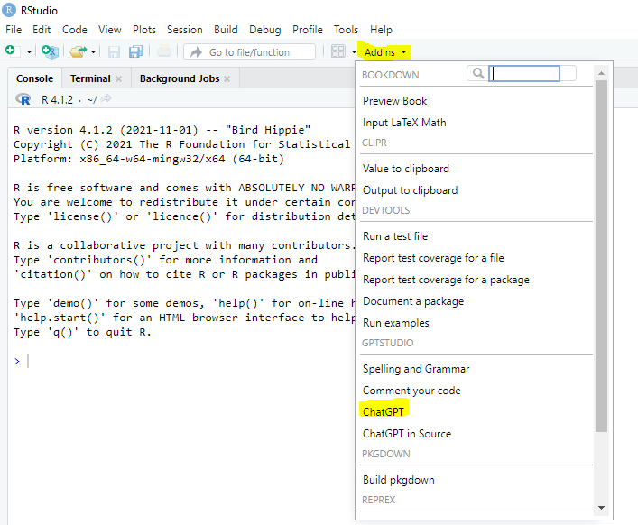
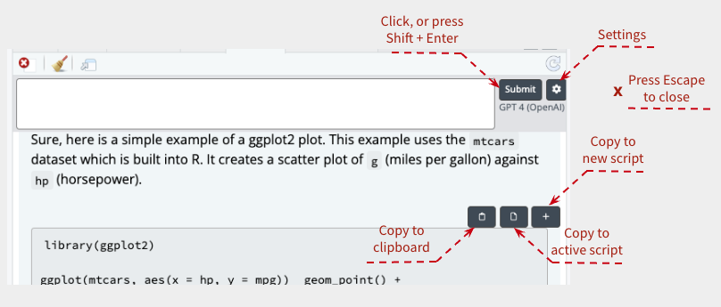
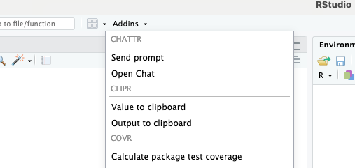

<right> 


# LLMs

**El código de esta sección no se ejecuta por defecto.**


## ChatGPT en Rstudio

Se puede instalar la librería `gptstudio` y en ese caso aparecerá en `Addins`. El problema es que hace falta la versión premium de ChatGPT para que funcione bien.


{fig-align="center"}


## Conectar con un LLM

Siguiendo este [post](https://blogs.rstudio.com/ai/posts/2024-04-04-chat-with-llms-using-chattr/) voy a conectar Rstudio a mi cuenta de OpenAI a través del paquete `chattr`.

::: callout-warning
## Aviso

Esta parte del código no se ejecuta por defecto por tres razones:

- Hace falta tener una cuenta de OpenAI. 
- Por ahora no funciona dentro del Markdown.
- Es una versión muy preliminar y el API no siempre responde.

:::

```{r}
#| eval: false

# Instalamos el paquete chattr
remotes::install_github("mlverse/chattr")
```

Para que funcione, tenemos que incluir en el fichero de las variables de entorno.

En Ubuntu editamos el fichero con:

>nano ~/.Renviron

E incluimos dentro:

>OPENAI_API_KEY=nuestro_openai_pat_aqui

Guardamos con `Ctrl + O` y `Enter` para confirmar. Salimos con `Ctrl + X`.

Podemos comprobar si lo hemos grabado si ejecutamos en la consola de R:

>Sys.getenv("OPENAI_API_KEY")

Otra forma es con `usethis::edit_r_environ()` como veremos mas adelante.

```{r}
#| eval: false

library(chattr)
```

Selecciono el modelo que voy a usar:

```{r}
#| eval: false

chattr_use()

# ── chattr - Available models 
# Select the number of the model you would like to use:
# 
# 1: OpenAI - Chat Completions - gpt-4.1-mini (gpt41-mini) 
# 
# 2: OpenAI - Chat Completions - gpt-4.1-nano (gpt41-nano) 
# 
# 3: OpenAI - Chat Completions - gpt-4.1 (gpt41) 
# 
# 4: OpenAI - Chat Completions - gpt-4o (gpt4o) 
# 
# 5: Ollama - llama3.2 (ollama) 

# ── chattr 
# • Provider: Ollama
# • Model: llama3.2
# • Label: Llama 3.2 (Ollama)
```

Reviso los valores de la sesión.

```{r}
#| eval: false

chattr_defaults()

# ── chattr ───────────────────────────────────────────────────────────────────────────────────────────────────────────────
# 
# ── Defaults for: Default ──
# 
# ── Prompt: 
# • {{readLines(system.file('prompt/base.txt', package = 'chattr'))}}
# 
# ── Model 
# • Provider: OpenAI - Chat Completions
# • Path/URL: https://api.openai.com/v1/chat/completions
# • Model: gpt-4o
# • Label: GPT 4 Omni (OpenAI)
# 
# ── Model Arguments: 
# • temperature: 0.01
# • max_tokens: 1000
# • stream: TRUE
# 
# ── Context: 
# Max Data Files: 0
# Max Data Frames: 0
# ✔ Chat History
# ✖ Document contents

How can I assist you with R today? Do you have a specific problem or project in mind?
    # ── chattr ─────────────────────────────────────────────────────────────────────────────────────────────────────────────────
# 
# ── Defaults for: Default ──
# 
# ── Prompt: 
# 
# ── Model 
# • Provider: Ollama
# • Model: llama3.2
# • Label: Llama 3.2 (Ollama)
# 
# ── Context: 
# Max Data Files: 0
# Max Data Frames: 0
# ✖ Chat History
# ✖ Document contents
```

```{r}
#| eval: false

chattr_test()
```

Y lanzamos el app.

```{r}
#| eval: false

chattr_app()
```

Se puede evitar la pregunta y lanzar directamente con:

```{r}
#| eval: false

library(chattr)
# chattr_use("gpt4")
chattr_use("ollama")
chattr_app()
```


## Conversar en Rstudio

Desde el `Viewer`.


{fig-align="center"}

**CUIDADO. En la última instalación de esta parte, he tenido resultados erráticos.**

Desde el `Tools / Addins`.


{fig-align="center"}


## Configuración avanzada

Es posible personalizar muchos aspectos de tu interacción con el LLM. Para hacerlo, utiliza la función `chattr_defaults()`. Esta función muestra y establece el mensaje adicional enviado al LLM, el modelo a utilizar, determina si el historial del chat se envía al LLM y los argumentos específicos del modelo.

Por ejemplo, si deseas cambiar el número máximo de tokens utilizados por respuesta, para OpenAI puedes usar esto:

```{r}
#| eval: false

# Default for max_tokens is 1,000
library(chattr)
chattr_use("gpt4")
chattr_defaults(model_arguments = list("max_tokens" = 100))
#> 
#> ── chattr ──────────────────────────────────────────────────────────────────────
#> 
#> ── Defaults for: Default ──
#> 
#> ── Prompt:
#> • {{readLines(system.file('prompt/base.txt', package = 'chattr'))}}
#> 
#> ── Model
#> • Provider: OpenAI - Chat Completions
#> • Path/URL: https://api.openai.com/v1/chat/completions
#> • Model: gpt-4
#> • Label: GPT 4 (OpenAI)
#> 
#> ── Model Arguments:
#> • max_tokens: 100
#> • temperature: 0.01
#> • stream: TRUE
#> 
#> ── Context:
#> Max Data Files: 0
#> Max Data Frames: 0
#> ✔ Chat History
#> ✖ Document contents
```

Si deseas hacer persistentes tus cambios en las configuraciones predeterminadas, utiliza la función `chattr_defaults_save()`. Esto creará un archivo yaml, llamado `chattr.yml` por defecto. Si se encuentra, `chattr` utilizará este archivo para cargar todas las configuraciones predeterminadas, incluyendo el modelo seleccionado.

Una descripción más extensa de esta característica está disponible en el sitio web de `chattr` en [Modify prompt enhancements](https://mlverse.github.io/chattr/articles/prompt_defaults.html).


## Mas allá del app

Además del Shiny app, `chattr` ofrece otras formas para interactuar:

- Usar la función `chattr()`.
- Remarcar una pregunta en tu código y usarla como entrada.

**CUIDADO. En la última instalación de esta parte, he tenido resultados erráticos.**

```{r}
#| eval: false

chattr("how do I remove the legend from a ggplot?")
#> You can remove the legend from a ggplot by adding 
#> `theme(legend.position = "none")` to your ggplot code. 
```

Se puede encontrar un artículo con mas información [aquí](https://mlverse.github.io/chattr/articles/other-interfaces.html).

**Probar con library(openai)**

[API de OpenAI](https://irudnyts.github.io/openai/).

```{{r}}
data <- df |>
  group_by(job) |>
  summarise(frauds = sum(is_fraud)) |>
  arrange(desc(frauds))
api_out <- openai::create_completion(
  model = "gpt-3.5-turbo-instruct",
  prompt = sprintf("De acuerdo con el siguiente data frame, cita los jobs con más fraudes y da sugerencias de por qué ocurre: %s ", data), 
  max_tokens = 64
)

api_out$choices$text
saveRDS(api_out, "app1/api_out.rds")
```


## Usando Llama con chattr

Para instalar Llama seguimos [estas instrucciones](https://github.com/kuvaus/LlamaGPTJ-chat#gpt-j-llama-and-mpt-models).

```{}
git clone --recurse-submodules https://github.com/kuvaus/LlamaGPTJ-chat

cd LlamaGPTJ-chat
```

Y luego:

```{}
mkdir build
cd build
cmake ..
cmake --build . --parallel
```

```{r}
#| eval: false

library(chattr)

# chattr_use("llamagpt")
chattr_use("ollama")
# ── chattr 
# • Provider: Ollama
# • Model: llama3.2
# • Label: Llama 3.2 (Ollama)
```

**CUIDADO. En la última instalación de esta parte, he tenido resultados erráticos.**

```{r}
#| eval: false

chattr("how do I remove the legend from a ggplot?")
```

La lista completa de [comandos](https://github.com/kuvaus/LlamaGPTJ-chat#detailed-command-list).


## Mas Llama

**Este está instalado en mi portátil**

**En este momento esta parece la forma más fácil de empezar con LLMs.**

Instalamos con ayuda de las librerías [ollama-r](https://hauselin.github.io/ollama-r/) y [mall](https://github.com/mlverse/mall) 

En Ubuntu:

```{}
curl -fsSL https://ollama.com/install.sh | sh
```

Otras versiones en [ollama download](https://ollama.com/download) 

Y un ejemplo obtenido a partir de este [tweet](https://x.com/bastimapache/status/1851407903124504839)

Preparamos el modelo (sólo hay que hacerlo una vez).

```{r}
#| eval: false

install.packages("ollamar")
library(ollamar)

# Vemos si el servidor se está ejecutando
test_connection()
```

El listado de los modelos lo podemos ver en la [página de Ollama](https://ollama.com/search) y en [Github Ollama](https://github.com/ollama/ollama).

```{r}
#| eval: false

# Descargamos el modelo
pull("llama3.2")
```

Podemos hacerlo directamente desde el terminal.

>ollama pull llama3.3

Para quitar un modelo, por ejemplo `llama3.3`.

En el terminal.

>ollama rm llama3.3

Probamos que funciona la conexión.

```{r}
#| eval: false

library(ollamar)

# Revisamos que está disponible
test_connection()
```

Listamos los modelos disponibles (descargados).

```{r}
#| eval: false

list_models()
#                 name    size parameter_size quantization_level            modified
# 1 deepseek-r1:latest  5.2 GB           8.2B             Q4_K_M 2025-06-18T13:30:50
# 2      gemma3:latest  3.3 GB           4.3B             Q4_K_M 2025-06-18T13:31:58
# 3     gpt-oss:latest 13.8 GB          20.9B              MXFP4 2025-08-07T08:06:06
# 4      llama3:latest  4.7 GB           8.0B               Q4_0 2025-06-18T13:06:01
# 5    llama3.2:latest    2 GB           3.2B             Q4_K_M 2025-06-11T17:51:11
# 6     mistral:latest  4.1 GB           7.2B               Q4_0 2025-06-18T13:25:36
```


### Una historia

Pedimos una historia.

```{r}
#| eval: false

# Generamos una respuesta basada en un prompt
respuesta <- generate("llama3.2", "tell me a 10-word story") 
respuesta
```

Vemos la respuesta.

```{r}
#| eval: false

# Usamos resp_process
resp_process(respuesta, "text")
```


### Un análisis de sentimiento

Y analizamos sentimientos en un csv de prueba.

**Este es uno de lo usos mas estable.**

```{r}
#| eval: false
#| message: false

# https://github.com/bastianolea/prensa_chile/blob/main/datos/prensa_datos_muestra.csv
url <- "./data/prensa_datos_muestra.csv"
datos_prensa <- readr::read_csv2(url)

datos_prensa %>%
    # Nos quedamos con el título
    select(titulo) %>%
    # Una muestra de 10
    slice_sample(n = 10) %>%
    # El análisis de sentimiento
    mall::llm_sentiment(titulo, pred_name = "sentimiento") %>%
    table()
```

```{r}
#| eval: false

head(datos_prensa)
# # A tibble: 6 × 3
#   titulo                                                                                                  cuerpo fecha     
#   <chr>                                                                                                   <chr>  <date>    
# 1 Dólar cierra sus operaciones con leve tendencia alcista y no quiebra barrera de los $800                "Este… 2023-03-10
# 2 Caso Convenios: Consejo de Defensa del Estado presenta querella contra director de Fundelin y represen… "El C… 2023-08-11
# 3 Nuevo estudio revela que un café con leche tiene prometedoras propiedades antiinflamatorias             "De a… 2023-01-30
# 4 Contraloría oficia a 53 municipalidades del país por niveles de limpieza y salubridad en espacios públ… "La C… 2024-01-24
# 5 Realizan funerales de los dos trabajadores fallecidos en el accidente de trenes                         "Dura… 2024-06-23
# 6 Partido Comunista vuelve a la conducción de la FECH: La ministra Vallejo había sido su última presiden… "“Con… 2023-08-30
```

**El siguiente bloque de código tarda un rato en ejecutarse.**

```{r}
#| eval: false
#| message: false

resumen_datos_prensa <- datos_prensa %>%
    select(titulo, cuerpo) %>%
    slice_sample(n = 20) %>%
    mutate(resumen = mall::llm_vec_custom(cuerpo, "resumir en hasta 5 palabras")) %>%
    select(resumen, titulo)

resumen_datos_prensa
```


## Datacamp datalab

En [Datacamp datalab](https://www.datacamp.com/datalab/) podemos trabajar con un LLM y crear interactivamente un notebook.


## Elmer (o ellmer)

[Elmer - Gitub](https://github.com/hadley/elmer/)

```{r}
#| eval: false

pak::pak("hadley/elmer")
```

Algunas de la viñetas de `elmer`:

* Learn key vocabulary and see example use cases in `vignette("ellmer")`.
* Learn how to design your prompt in `vignette("prompt-design")`.
* Learn about tool/function calling in `vignette("tool-calling")`.
* Learn how to extract structured data in `vignette("structured-data")`.
* Learn about streaming and async APIs in `vignette("streaming-async")`.

```{r}
#| eval: false

vignette("ellmer")
```

```{r}
#| eval: false

library(ellmer)
library(httr2)

# Assumes $OPENAI_API_KEY is set

chat <- ellmer::chat_openai(
  # model = "gpt-4o",
  system_prompt = "Be terse but professional."
)

chat$chat("When was the R language created?")
```

```{r}
#| eval: false

library(ellmer)

chat <- chat_openai(
  model = "gpt-4o-mini",
  system_prompt = "You are a friendly but terse assistant.",
  echo = TRUE
)
```

```{r}
#| eval: false

live_console(chat)
```

```{r}
#| eval: false

chat <- elmer::chat_openai(model = "gpt-4o-mini")
chat$chat("Tell me a story.")
```

```{r}
#| eval: false

library(openmeteo)

#' Get current weather data from Open-Meteo using openmeteo package
#'
#' @param lat The latitude of the location.
#' @param lon The longitude of the location.
#' @return A list containing current weather information including temperature (F), wind speed (mph), and precipitation (inch).
get_current_weather <- function(lat, lon) {
  openmeteo::weather_now(
    c(lat, lon),
    response_units = list(temperature_unit = "celsius", 
                          windspeed_unit = "kmh", 
                          precipitation_unit = "mm")
  ) |> jsonlite::toJSON(auto_unbox = TRUE)
}
```

```{r}
#| eval: false

library(ellmer)
chat <- chat_openai(model = "gpt-4o")

chat$register_tool(tool(
  get_current_weather,
  "Get current weather data from Open-Meteo using openmeteo package. Returns a list containing current weather information including temperature (F), wind speed (mph), and precipitation (inch).",
  lat = type_number("The latitude of the location."),
  lon = type_number("The longitude of the location.")
))
```

[OpenAI API error codes](https://platform.openai.com/docs/guides/error-codes/api-errors)


## LLM con reticulate

```{r}
#| eval: false

library(tidyverse)
library(reticulate)

# Step 1: Create a virtual environment, if you've already created one please move on the step 2. This is a best practice. 
virtualenv_create(envname = "gemini")

## Step 1.1: Install the appropriate modules
py_install(c("google-generativeai", "langchain", "langchain-community",
             "pypdf", "python-dotenv"), pip = TRUE, virtualenv = "gemini")

# Step 2: Use the virtual environment
use_virtualenv("gemini")

# Step 3: Import installed modules
dotenv <- import("dotenv")
genai <- import("google.generativeai")
langchain_community <- import("langchain_community")
PyPDFLoader <- langchain_community$document_loaders$PyPDFLoader
langchain <- import("langchain")
PromptTemplate <- langchain$prompts$PromptTemplate

# Step 4: Load your API keys onto a .env file - see https://pypi.org/project/python-dotenv/
dotenv$load_dotenv(dotenv_path = ".env")
```

```{r}
#| eval: false

# Step 5: Load PDF of interest
loader = PyPDFLoader("/media/enero/Disco3ATA/Varios/Gitlab/r_clases/LLM/data/amr-guidance-4.0.pdf")
documents = loader$load()

# Step 6: Setup Gemini
genai$configure() #if you're skipping dotenv, insert your API key here

llm <- genai$GenerativeModel(
  'gemini-1.5-flash', 
  generation_config=genai$GenerationConfig(
  max_output_tokens=2000L,
  temperature=0
))

# Step 7 (optional): Test
llm$generate_content(contents = "hello") # you should see a return of text and tokens etc.
```

```{}
response:
GenerateContentResponse(
    done=True,
    iterator=None,
    result=protos.GenerateContentResponse({
      "candidates": [
        {
          "content": {
            "parts": [
              {
                "text": "Hello there! How can I help you today?\n"
              }
            ],
            "role": "model"
          },
          "finish_reason": "STOP",
          "avg_logprobs": -0.0006325314752757549
        }
      ],
      "usage_metadata": {
        "prompt_token_count": 1,
        "candidates_token_count": 11,
        "total_token_count": 12
      },
      "model_version": "gemini-1.5-flash"
    }),
)
```

```{r}
#| eval: false

# Step 8: Prompt
prompt_text = "
You are a question and answer assistant. Given the context below, answer the question.

Context: {text}

Question: {question}    
"

prompt = PromptTemplate(template=prompt_text, input_variables=list("text", "question"))

questions = c(
  "What is the preferred treatment of CRE?",
  "What is the preferred treatment of ESBL-E?",
  "Can we use fosfomycin in ESBL Klebsiella?",
  "Can we use fosfomycin in ESBL Ecoli?",
  "What is the preferred treatment of stenotrophomonas?",
  "What is the preferred treatment of DTR Pseudomonas?",
  "Which organisms require two active agent when susceptibility is known?",
  "Can we use gentamicin in pseudomonas infection?",
  "Can we use tobramycin to treat pseudomonas infection?",
  "Why is there carbapenemase non-producing organism?",
  "Can we use oral antibiotics for any of these MDRO?",
  "What is the preferred treatment of MRSA?",
  "What is the preferred treatment of CRAB?",
  "Can fosofmycin be used for pyelonephritis?",
  "Is IV antibiotics better than oral antibiotics?"
)

content = prompt$format(
  text=documents,
  question=questions
)

# Step 9: Generate Content / aka Langchain lingo == invoke
response <- llm$generate_content(contents=content)

# Step 10: Let's simulate a streaming response
print_keystrokes <- function(text) {
  for (char in strsplit(text, "")[[1]]) {
    cat(char) # Print the character
    Sys.sleep(0.005) # Optional delay for visual effect
  }
  cat("\n") # Add a newline at the end
}

print_keystrokes(response$text)
```


## Recopilatorio LLMs

- [Huggingface Chat](https://huggingface.co/chat/)
- [Summarize.tech: AI-powered video summaries](https://www.summarize.tech/)
- [MissionAI](https://missionai.io/)
- [Copilot](https://copilot.microsoft.com/)
- [Gemini](https://gemini.google.com/app)
- [Claude AI](https://claude.ai/onboarding?returnTo=%2F%3F)
- [Perplexity AI](https://www.perplexity.ai/?login-source=oneTapHome)


## El entorno

Acabamos con la información de la sesión con `sessionInfo()`. Esto lo incluimos para en caso de error facilitar el seguimiento del mismo.

```{r}
sessionInfo()
```

Los siguientes bloques no los ejecuto porque contienen información del sistema que podría ser algo sensible.

```{r}
#| eval: false

Sys.getenv()
```

```{r}
#| eval: false

Sys.info()
```

```{r}
#| eval: false

benchmarkme::get_sys_details()
```

Estas funciones nos permite, por ejemplo, guardar la versíón de R en una variable. 

```{r}
version_r <- sessionInfo()$R.version$version.string
version_r
```


Para [instalar FontAwesome](https://github.com/quarto-ext/fontawesome#readme), abro un terminal en el directorio del proyecto y escribo:

>quarto add quarto-ext/fontawesome

<span style="color:white"></span>
